<div align="center">

[](https://github.com/technailly-khani)

<!-- Add your LinkedIn link below once your profile exists, then remove the comment markers -->
<!-- [](https://www.linkedin.com/in/YOUR-LINK) -->
[](https://github.com/technailly-khani)

</div>


## 🌀 whoami
```bash
$ whoami
javeria-khan

$ cat about.txt
BSAI student at SZABIST Hyderabad.
I build desktop apps, games and AI projects,
and I'm learning data structures and algorithms along the way.

$ ls hobbies/
reading  cooking  crochet  movies  creative-writing  marvel
```

## 🧶 stack
<p align="center">
  
</p>


## 🍭 projects
| Project | What it does | Tech |
|---|---|---|
| 🍔 [Burger Rush](https://github.com/technailly-khani/burger-rush) | Restaurant game with queues, stacks, a shop and random events | Python, Tkinter |
| 🩸 Blood Report Analyzer | Predicts diseases from CBC blood reports | Python, ML |

## 📊 stats
<div align="center">
  
  
</div>

<div align="center">
  
</div>


## 🐍 the snake


