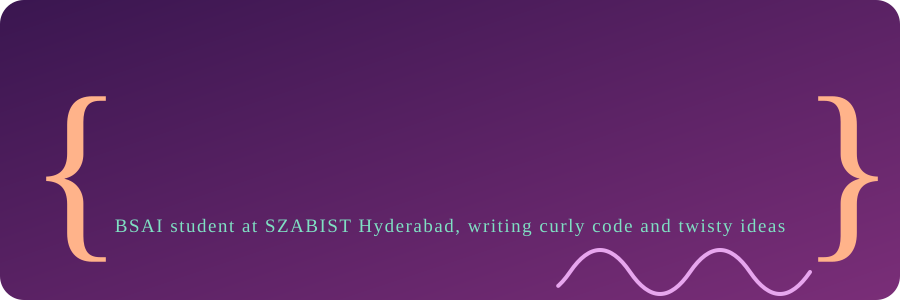

<div align="center">

[](https://github.com/technailly-khani)

</div>


## 🌀 { about }
```python
class Javeria:
    degree    = "BSAI @ SZABIST Hyderabad"
    codes_in  = ["Python", "Java", "C++"]
    speaks    = ["English", "Urdu", "Sindhi", "Balochi"]
    currently = "building curly little projects and learning DSA"
    unwinds   = ["reading", "cooking", "crochet", "movies"]
```

## 🧶 { tech stack }
<p align="center">
  
</p>


## 🍭 { projects }
| Project | What it does | Tech |
|---|---|---|
| 🍔 [Burger Rush](https://github.com/technailly-khani/burger-rush) | Restaurant game with queues, stacks, a shop and random events | Python, Tkinter |
| 🩸 Blood Report Analyzer | Predicts diseases from CBC blood reports | Python, ML |

## 🎀 { beyond code }
📚 reading &nbsp; 🍳 cooking &nbsp; 🧶 crochet &nbsp; 🎬 movies &nbsp; ✍️ creative writing &nbsp; 🦸 Marvel &nbsp; 🌐 web tools


## 🐍 { the snake }

